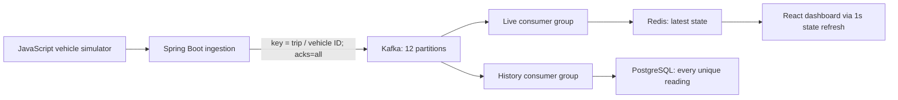

# CabWatch Java

A separate Java/Spring Boot and React migration of [CabWatch](https://github.com/vermavaibhav23/CabWatch), based on original commit a47f8530eca3577294e4b90b281133cc5a5fe342. The original repository and its running service are not modified. Original Python sources are retained in `legacy-python/` for comparison, not executed by the new service.

## Architecture



Each simulated trip represents a distinct active vehicle. The vehicle simulator, road graph, Dijkstra routing, detour and return behavior derive from the Python project. The dashboard renders confirmed consumer state, not the simulator's optimistic position.

## Freshness and recovery

Live detection uses cached routes, a Redis bulk read and pipelined atomic writes, not a PostgreSQL query or Redis round trip for every point. Readings over 10 seconds old are acknowledged by the live group without route evaluation. They mark the vehicle DELAYED, clear the consecutive-reading counter and cannot overwrite the last fresh coordinates. The independent history group stores them normally. After recovery, three consecutive fresh off-route readings are needed to confirm a deviation. Missing sequences, reversed timestamps and long time gaps reset confirmation. Duplicate sequences never rewind state. An idle vehicle is also displayed as delayed after 10 seconds without fresh telemetry.

This implementation drains stale records cheaply rather than seeking to the partition end, which could discard the only reading for quieter vehicles. Redis adds network overhead; skipping stale data is not a guarantee of bounded recovery during sustained overload. Kafka retains history for its configured broker retention, not indefinitely. Provision retention/disk capacity for the largest supported history outage.

The consumer groups have independent offsets; a history database outage does not directly stop live processing. Both listeners currently run in one JVM and share host resources. Separate deployments are the next isolation step before production. Partitions bound consumer parallelism; default concurrency is 3 per group, with 12 partitions. Redis sequence comparison protects against late writers after rebalances. Redis failure intentionally stops live acknowledgments; restoration replays data and rechecks freshness.

## Run

Set a private `OPERATOR_PASSWORD` of at least 16 characters, then:

```sh
docker compose up --build
```

Open http://localhost:18081. This is a single-operator demonstration, not a multi-tenant production fleet service. Do not reuse the original app's database. Login issues an eight-hour signed bearer token kept only in React memory. Public deployments require HTTPS. The included localhost infrastructure is not configured for exposure to the internet.

## API

- `POST /api/auth`: obtain a token using the operator password.
- `GET /api/network`, `POST /api/trips`, `POST /api/trips/{id}/complete`.
- `POST /api/telemetry` or `/api/telemetry/batch` (up to 500 readings).
- `GET /api/state`, `/api/alerts`, `/api/trips/{id}/history?after=sequence`.
- Authenticated `/actuator/prometheus` for metrics.

HTTP 202 means Kafka acknowledged the reading, not that detection or history storage
has finished. Retry a failed send using the same event ID and sequence. The JavaScript
simulator saves its outbox before sending and only clears it after acknowledgment.

## Test

```sh
mvn -f backend/pom.xml verify
cd frontend
npm ci
npm test
npm run build
```

## Observability

Authenticated `/actuator/prometheus` exports Kafka client metrics, stale/duplicate counts, reading age and detection latency. Normal target is under 2 seconds, warning threshold is 5 seconds, stale cutoff is 10 seconds. These are design targets, not benchmark results or guarantees. Clock synchronization is necessary for end-to-end measurements. State transitions and idempotency are tested separately from infrastructure throughput.

## Scope and differences

The migration currently provides a single protected operator dashboard. Original signup/accounts, optional Gemini explanations and automatic retention cleanup remain in the legacy source; this edition uses operator login, deterministic explanations and preserves history until explicitly managed. Simulator motion and retry outboxes are saved locally across refreshes. React uses 1-second authenticated polling for processed state, not WebSocket; this polling does not accelerate the Kafka consumer. Multi-tenant authorization and production quotas are outside this operator-demo scope. Recent alert events are stored atomically with state in Redis and are capped at 200; PostgreSQL contains the complete telemetry history.

## Render

The validated `render.yaml` creates a new web service, private Kafka broker, Redis and PostgreSQL. It does not reference the original CabWatch resources. This configuration incurs recurring charges and must be reviewed in Render before provisioning. Supply `OPERATOR_PASSWORD` when prompted. No live Render URL is claimed until deployment and health checks succeed.

See [operations and deployment notes](docs/operations.md) and [measured validation results](docs/validation.md).
